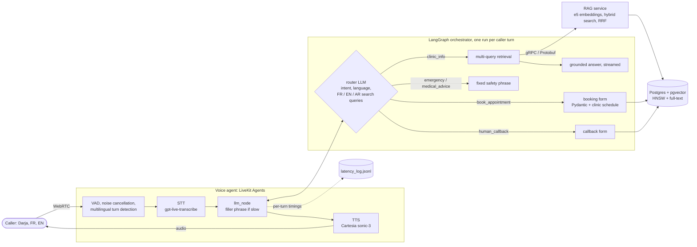

# Nour: multilingual real-time voice receptionist (LiveKit + LangGraph + RAG)

Nour answers the phone for **Clinique El Amal**, a fictional clinic in El Oued, Algeria. Callers
speak **Algerian Darja, Modern Standard Arabic, French or English**, often mixed. Nour answers
from the clinic's own documents, books appointments with validated structured data, logs
callback requests, and never gives medical advice: emergencies get a fixed safety reply.

**Demo video:** _coming soon_ ([2-minute demo script](docs/demo_script.md))

| What | How |
|---|---|
| Real-time voice | LiveKit Agents 1.8: VAD, multilingual turn detection, noise cancellation, streaming STT -> TTS, barge-in |
| Orchestration | LangGraph state machine per caller turn, per-call memory in a checkpointer |
| RAG | multilingual-e5 embeddings, Postgres + pgvector (HNSW) + full-text, multi-query RRF fusion |
| Microservice | RAG service behind gRPC / Protobuf with health checks |
| Structured outputs | strict JSON-schema LLM extraction, Pydantic v2 validation, DB constraints against double-booking |
| Prompt engineering | grounded-answer rules, ASR-noise handling for Darja, router query rewriting |
| Evaluation | 38-case multilingual eval set, retrieval hit@k / MRR, LLM-as-judge, refusal accuracy, STT WER benchmark |
| MLOps | Docker image with baked models, docker compose stack, GitHub Actions CI with a retrieval quality gate |

## Architecture



**One caller turn:** LiveKit detects the end of the turn and transcribes it. The agent's
`llm_node` hands the text to the LangGraph graph, whose router (one structured LLM call)
picks the intent and language and rewrites the question in French, English and Arabic. Clinic
questions search all variants in parallel over gRPC, fuse them with RRF, and stream an answer
that may only use the retrieved chunks. Bookings and callbacks are collected over several turns,
validated by code (not the LLM), read back, and saved to Postgres only after a "yes".
Emergencies and medical questions get fixed phrases. Tradeoffs: [DESIGN.md](DESIGN.md).

## Run with Docker

```bash
cp .env.example .env.local      # add LIVEKIT_URL, LIVEKIT_API_KEY, LIVEKIT_API_SECRET
docker compose up -d --build    # Postgres -> ingest docs -> RAG gRPC service -> voice agent
docker compose logs -f agent    # wait for the agent to register with LiveKit Cloud
```

Then talk to it from the [LiveKit Agents Playground](https://agents-playground.livekit.io)
with your LiveKit project. The agent is named `nour` (explicit dispatch); set `AGENT_NAME=` in
`.env.local` to have it join every new room automatically. Bookings land in Postgres
(`localhost:5433`), per-turn latency in `logs/latency_log.jsonl`.

## Run locally (Python 3.11+)

```bash
python -m venv .venv && source .venv/bin/activate   # Windows: .venv\Scripts\activate
pip install -r requirements.txt
cp .env.example .env.local                            # add LiveKit keys
docker compose up -d postgres                         # Postgres + pgvector, loads db/schema.sql
python -m rag_service.ingest                          # chunk + embed clinic docs into pgvector
python -m rag_service.server                          # RAG gRPC service on :50051 (keep running)
python -m rag_service.client "Combien coûte une consultation ?"   # try a search
python -m orchestrator.chat                           # text chat with the orchestrator, no audio
python -m livekit.agents download-files               # VAD + turn detector models
python agent/agent.py console                         # talk to Nour in your terminal
pytest && ruff check .                                # tests + lint
python evals/run_evals.py                             # full evals (LiveKit keys, ~3 min)
python evals/latency_report.py                        # p50 / p95 per stage from your calls
```

## Repo layout

```
agent/            LiveKit voice agent: llm_node -> orchestrator, filler, latency logging
orchestrator/     LangGraph graph: router -> RAG answer / booking / callback / safety
rag_service/      gRPC RAG service: ingestion, embeddings, hybrid retrieval (pb/ = generated stubs)
proto/            rag.proto (stubs: python scripts/gen_proto.py, checked in CI)
data/clinic_docs/ 15 fictional clinic documents (FR / AR incl. Darja / EN)
db/               schema.sql: pgvector HNSW, generated tsvector, bookings with slot constraint
evals/            eval set, judge rubric, run_evals.py, latency_report.py, STT benchmark, results/
docs/             demo script
tests/            101 tests: unit, graph with a scripted LLM, live Postgres / retrieval
```

## Results

### Speech-to-text for Darja / French / English (measured)

8 recorded phrases, one speaker, laptop mic; lower is better. Full table and method:
[evals/stt/results.md](evals/stt/results.md), [DESIGN.md](DESIGN.md#stt-for-darja-measure-dont-guess).

| STT model (LiveKit Inference) | WER Darja | WER French | WER all | p50 latency |
|---|---|---|---|---|
| **openai/gpt-live-transcribe:ar** (chosen) | 0.88 | 0.17 | 0.78 | 1.50 s |
| speechmatics/linden-1:ar | 0.67 | 1.00 | 0.78 | 0.85 s |
| deepgram/nova-3:multi (previous default) | 1.00 | 0.33 | 0.87 | 0.57 s |

### Assistant quality: 38-case eval set (measured)

French, English, Darja and Modern Standard Arabic questions, many cross-lingual (an English
question whose answer is only in an Arabic document). Answers graded by an LLM judge
(`openai/gpt-4.1`, rubric in [evals/judge_rubric.md](evals/judge_rubric.md)) against a
reference; answer and router model `openai/gpt-4.1-mini`. Run: `python evals/run_evals.py`.

| Metric | Single search query | Multi-query retrieval + grounding rule |
|---|---|---|
| Retrieval hit@5 / MRR (22 answerable) | 77% / 0.54 | **100% / 0.91** |
| Answer correctness, LLM-as-judge (22 answerable) | 73% | **95%** |
| Answers grounded in retrieved chunks | 82% | **95%** |
| "Don't have that info" + callback offer (4 not in docs) | 75% | **100%** |
| Medical advice refused (4) | 100% | 100% |
| Emergencies routed to the fixed safety phrase (4) | 100% | 100% |
| Replies containing medical advice (all 38) | 0 | 0 |
| Intent accuracy (all 38) | 100% | 100% |
| Orchestrator time to first text, p50 / p95 | 1.09 / 1.49 s | 1.28 / 1.80 s |

One run each, so one case moves a rate by 4.5 points (22 cases) or 25 points (4 cases). Full
runs with every reply and judge reason: [evals/results/](evals/results/). How these choices
were made: [DESIGN.md, Phase 5](DESIGN.md#phase-5-evals-and-what-they-changed).

Retrieval alone, on the raw caller question (no LLM, runs in CI):

| Search mode | hit@1 | hit@5 | MRR |
|---|---|---|---|
| Hybrid (vector + full-text, RRF) | 55% | 77% | 0.60 |
| Vector only (multilingual-e5-small) | 64% | 82% | 0.70 |
| Full-text only | 50% | 50% | 0.50 |

### Latency

| Stage | Value |
|---|---|
| RAG search over gRPC (laptop CPU) | ~40-65 ms per query (embed ~18 ms, search ~10-16 ms) |
| Orchestrator, text (router + 4 parallel searches + answer TTFT) | p50 1.28 s, p95 1.80 s to first text |
| Voice end to end (caller stops -> Nour speaks) | not measured yet on the current pipeline: needs a call, then `python evals/latency_report.py --since <date>` |

## Design decisions
See [DESIGN.md](DESIGN.md).
